# PFO 2 : Sistema de Gestion de tareas con API y Base de datos

Trabajo practico en el que se desarrolla una arquitectura cliente-servidor mediante una API Flask, cuenta con autenticacion
con contraseñas Hasheadas y el almacenamiento persistente con SQLite

# Un Poco mas del proyecto:

 * **API REST FLASK:** Cuenta con Endpoints funcionales para el registro de usuarios, autenticacion y las visualizaciones de tareas

 * **Seguridad:** Cuenta con Hasheo de contraseñas mediante la libreria werkzeug.security 

 * **Cliente interactivo en la terminal:** Corre el script en la consola para consumir los endpoints de la API de forma interactiva

# Como probar el codigo:

Requisitos:

* **Python version 3 o superior**
* **Flask** Framework para la API REST
* **SQLite3** para la base de datos (INCLUIDO CON PYTHON)
* **Requests** El cliente http para la terminal

## Instalaciones necesarias

En la consola, escribi los siguientes comandos para instalar las dependencias necesarias:

* python -m venv .venv
* .venv\Scripts\Activate.ps1
* pip install flask requests

## Como ejecutarlo

*1. En una terminal, inicia el servidor utilizando:
   ```
   python servidor.py
   ```
*2. En otra terminal aparte, ya con el servidor levantado, inicia el cliente con 
  ```
   python cliente.py
   ```


# Endpoints
| Metodo | Ruta | Descripcion | Body (JSON) |
|---|---|---|---|
| POST | `/registro` | Registra un usuario | `{"usuario": "Santiago", "contraseña": "1234"}` |
| POST | `/login` | Inicia sesion | `{"usuario": "Santiago", "contraseña": "1234"}` |
| GET | `/tareas` | Muestra un HTML de bienvenida | - |


* Codigos de respuesta: `201` registro correcto, `409` usuario existente, `200` login correcto, `401` credenciales invalidas, `400` faltan datos.


# Pruebas exitosas

## Pruebas con Postman

### 1. Registro de usuario exitoso 
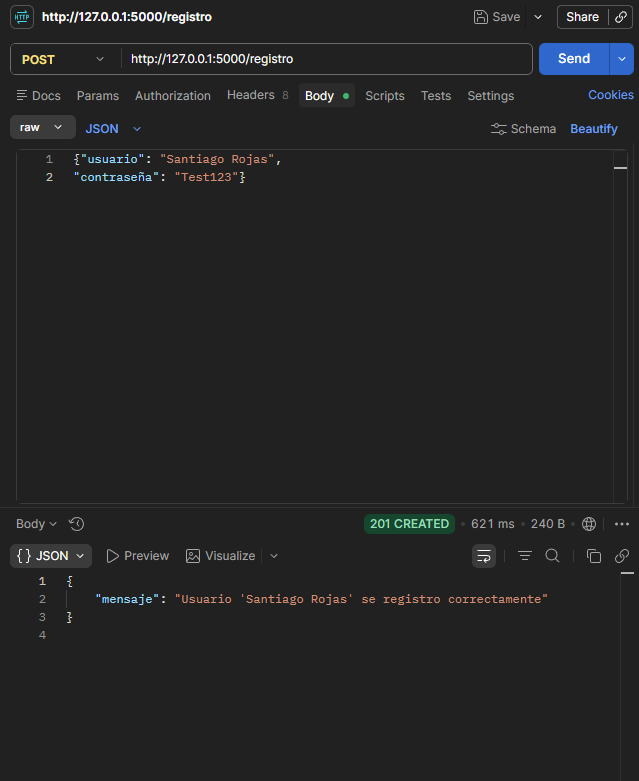

### 2. Contraseña hasheada en SQLite 
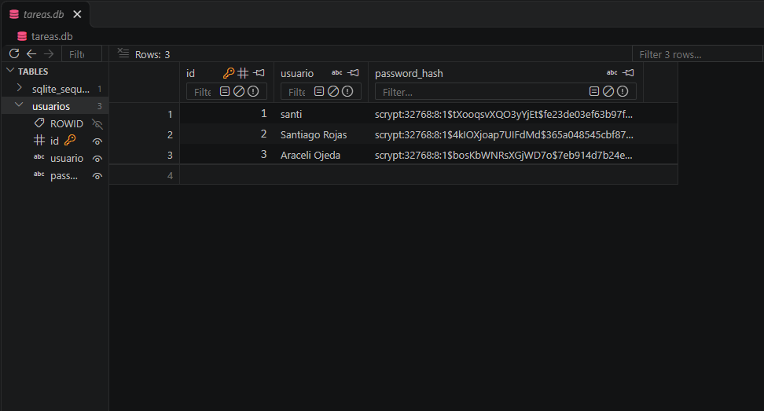

### 3. Inicio de sesion 
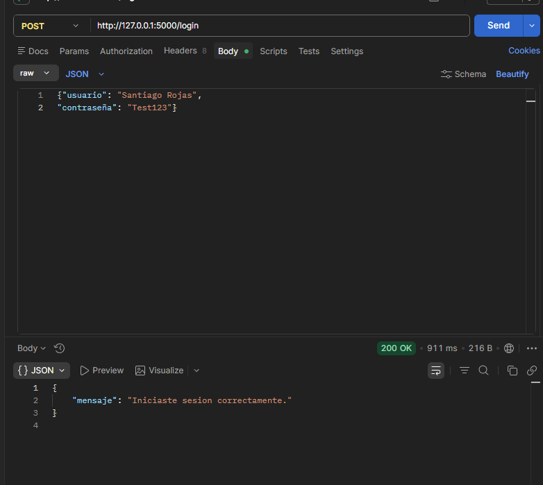

### 4. Vista de tareas
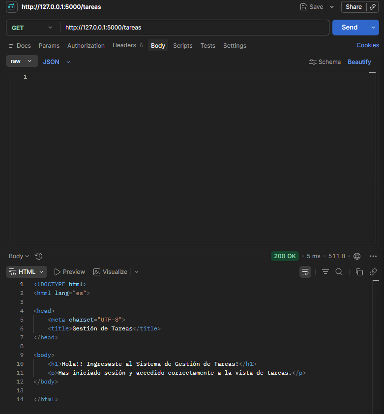

## Pruebas con la consola

### 1. Menu
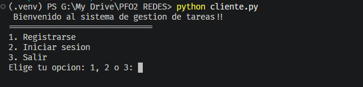

### 2. Registro de usuario
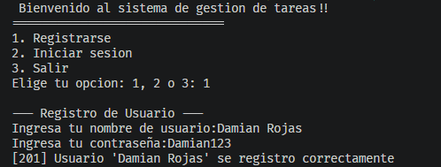

### 3. Inicio de sesion y acceso a tareas
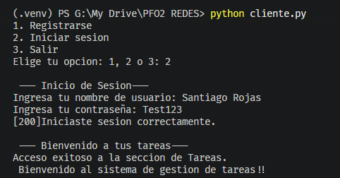

## Validacion de errores

### Usuario ya registrado
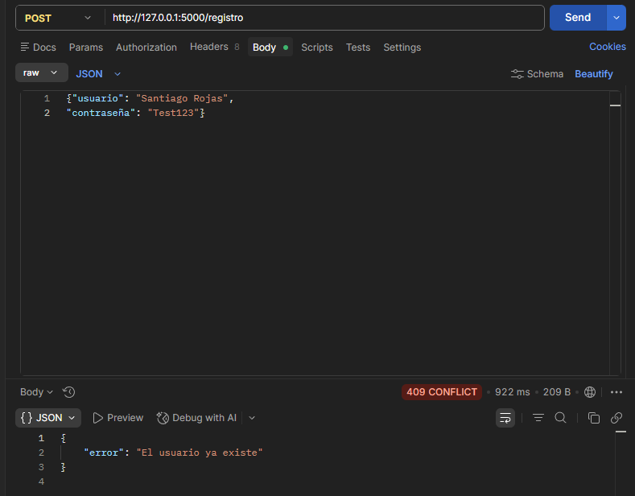
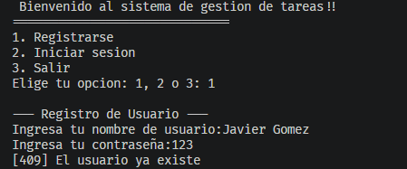

### Credenciales incorrectas 
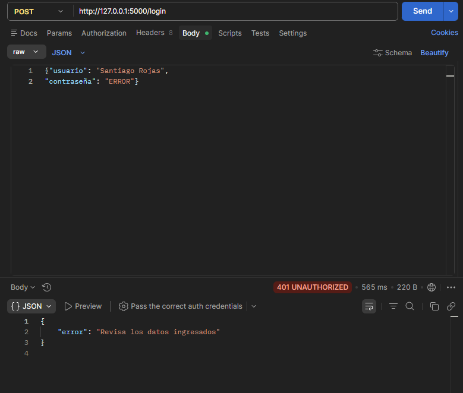
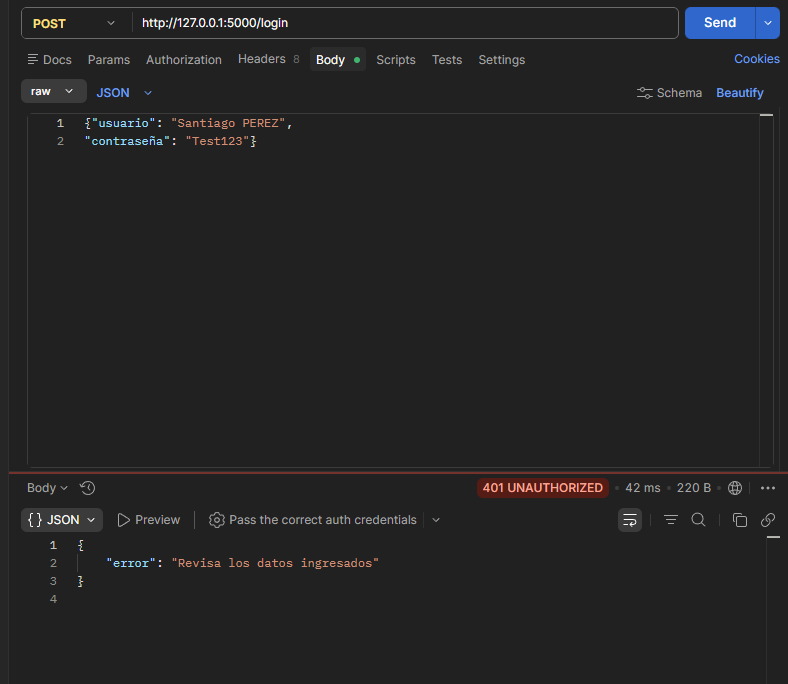
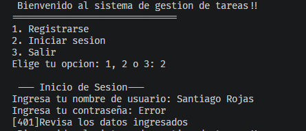


# Preguntas conceptuales:

## ¿Por qué hashear contraseñas?

* Se Hashean las contraseñas porque no se deben guardar contraseñas en texto plano. Se aplica el script del hash y la contraseña se combierte en una cadena fija.

* En caso de una vulnerabilidad en la base de datos y se filtraran las contraseñas, estas al estar hasheadas no correrian riesgo de quedar expuestas


## Ventajas de usar SQLite en este proyecto

* Las ventajas que se tienen al usar SQLite en este proyecto son que no se requiere instalar un servidor independiente como MySQL ya que se gestiona en un archivo local. Ademas viene previamente instalado en la bibloteca de Python